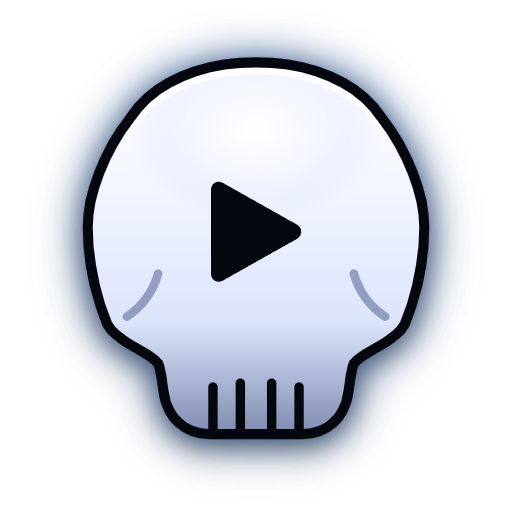
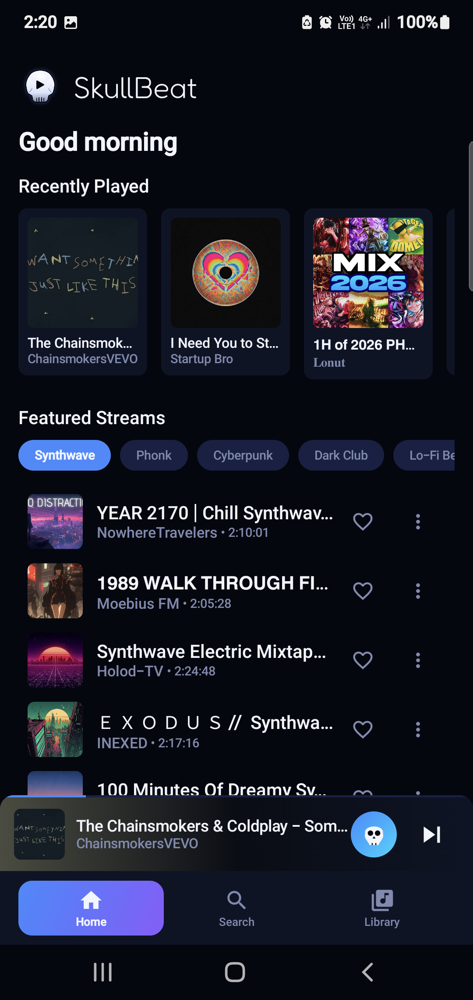
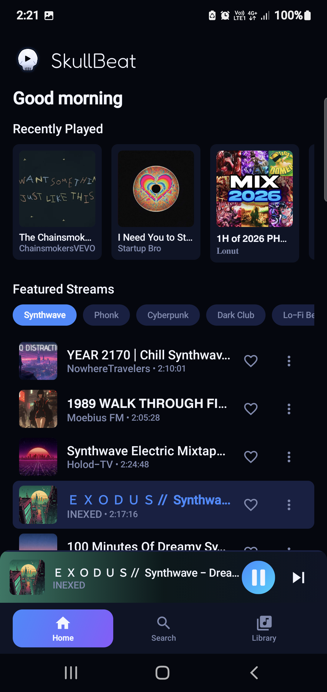
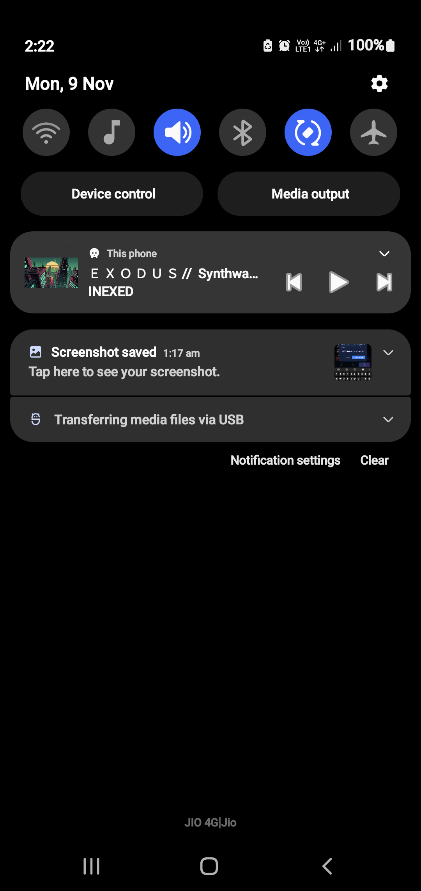
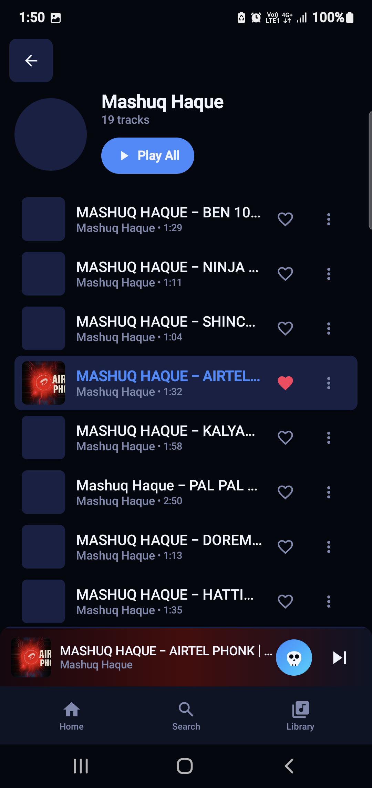

# SKULLBEAT 💀🎵

> High-fidelity, ad-free music streamer for Android & PC with pure audio streaming, Spotify/YouTube import, dynamic theming, and 80% bandwidth savings.

<p align="center">
  
</p>

<p align="center">
  <a href="download_apk/SkullBeat.apk"><b>📲 Download Android APK (SkullBeat.apk)</b></a>
</p>

---

## 📁 Repository Structure

```
SkullBeat/
├── android/             # Android native app (Kotlin, Jetpack Compose, Media3/ExoPlayer, Room)
│   ├── app/             # Application source code & resources
│   ├── gradle/          # Gradle wrapper configuration & version catalog
│   ├── build.gradle.kts # Project build configuration
│   ├── gradlew          # Unix build wrapper
│   └── gradlew.bat      # Windows build wrapper
│
├── pc/                  # PC Python web streamer & CLI suite
│   ├── app.py           # FastAPI + Tailwind web streaming server
│   ├── filter_music.py  # Advanced terminal CLI for library filtering & playback
│   ├── requirements.txt # Python dependencies
│   ├── run_audiotube.bat# One-click Windows desktop launcher
│   └── history/         # Persistent playback history & cached user library
│
├── download_apk/        # Ready-to-install Android package
│   └── SkullBeat.apk    # Latest pre-built release APK
│
├── pictures/            # Visual branding & verified app screenshots
│   ├── logo.png         # Official SkullBeat emblem
│   ├── screen_home.png  # Android home feed with Fredoka typography & skull controls
│   ├── screen_now_playing.png # Non-transparent full now-playing sheet with spinning skull
│   ├── screen_notification.png# Themed 2-color lock screen & drawer notification
│   ├── screen_artist.png# Artist discography & track browser
│   └── screen_splash.png# Pulsing skull launch animation
│
├── README.md            # Repository overview & setup guide
└── LICENSE              # MIT License
```

---

## 📱 Android App Features

<p align="center">
  
  
  
</p>

- **Instant One-Touch Playback**: Tap any track title or row to play immediately without double-tapping.
- **Spinning Skull Play Indicator**: The skull button spins smoothly during track loading and audio buffering.
- **Solid Dynamic Now Playing Sheet**: Non-transparent 100% opaque bottom sheet tinted by dynamic album art palette colors.
- **Themed Media Notification**: Dual-color shaded notification artwork extracted from song art, with full lock-screen playback controls (play/pause, skip, prev, shuffle).
- **Fredoka Typography**: Friendly, modern Fredoka typeface for all headers and brand elements.
- **CSV & Playlist Import**: Import music libraries via CSV file upload or paste any Spotify/YouTube link.
- **Local Storage & Offline Caching**: Room SQLite database stores favorites, custom playlists, recent history, and stream URLs.
- **Background Playback**: Foreground `MediaSessionService` ensures uninterrupted background streaming with Android 13/14 media notification integration.

### Quick Install (Android)
Download [`SkullBeat.apk`](download_apk/SkullBeat.apk) from the [`download_apk`](download_apk/) directory and install it on any Android device running Android 8.0 (API 26) or higher.

### Build from Source (Android)
```bash
cd android
./gradlew assembleDebug
```
The compiled APK will be generated at `android/app/build/outputs/apk/debug/app-debug.apk`.

---

## 💻 PC Web Streamer & CLI

<p align="center">
  
  
</p>

- **Pure Audio Streaming**: Direct extraction via `yt-dlp` saves up to 80% bandwidth over video.
- **FastAPI Web Server**: Responsive dark-mode interface with instant search and gapless audio.
- **Terminal CLI (`filter_music.py`)**: Filter personal YouTube Music library and stream directly in the console.

### Installation (PC)
```bash
cd pc
pip install -r requirements.txt
```

### Run the Web Player
```bash
cd pc
python app.py
```
Or double-click `run_audiotube.bat`. Open your browser at [http://localhost:8000](http://localhost:8000).

### CLI Usage
```bash
cd pc

# Search and filter music
python filter_music.py --source liked --artist "Coldplay"
python filter_music.py --min-duration 120 --max-duration 360

# Stream song directly via ffplay:
python filter_music.py --query "synthwave" --play 1

# Export playlist:
python filter_music.py --artist "Coldplay" --export coldplay_songs.csv
```

---

## 🎨 Color Palette (60-25-10-5)

| Role | Share | Hex | Description |
| :--- | :--- | :--- | :--- |
| **Background** | 60% | `#070B16` | Deep navy |
| **Surfaces & Cards** | 25% | `#0F1830` | Dark blue panels and elevated cards |
| **Primary Text & Icons** | 10% | `#EAF0FF` | Bone white text and headers |
| **Secondary Text** | — | `#8A96B8` | Muted blue-gray for channels and timestamps |
| **Accent** | 5% | `#2F7BFF` | Electric blue for active indicators, sliders, buttons |

---

## 📜 License

Distributed under the [MIT License](LICENSE).
